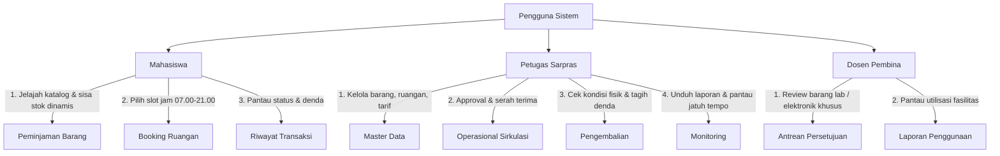
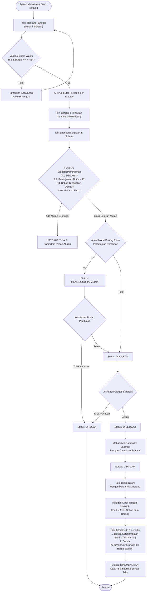
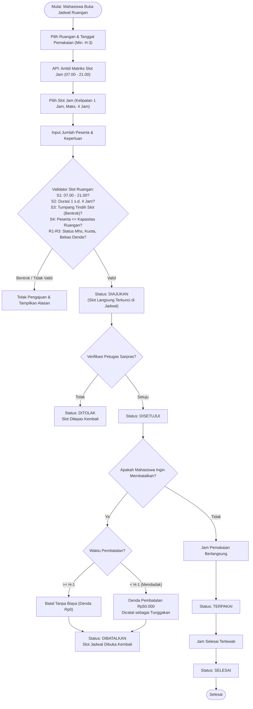
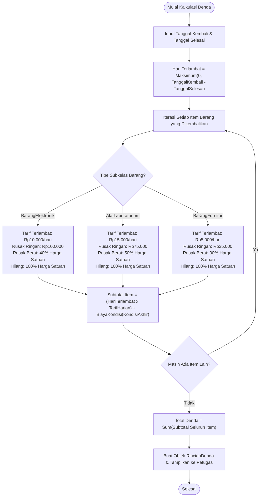
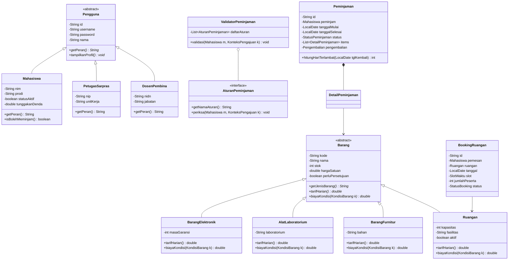

# DOKUMEN ARSITEKTUR, DESKRIPSI SISTEM & DESIGN SYSTEM
## SIPINJAM (PinjamYuk) — Sistem Peminjaman Inventaris, Sarana Prasarana, dan Ruangan Kampus

---

## 1. Deskripsi Aplikasi

### 1.1 Latar Belakang & Masalah
Pengelolaan sarana dan prasarana di lingkungan kampus sering menghadapi kendala operasional akibat pencatatan manual:
1. **Ketidakpastian Ketersediaan Barang**: Mahasiswa harus datang langsung untuk menanyakan sisa stok proyektor, speaker, atau alat lab pada tanggal kegiatan mereka.
2. **Double Booking Ruangan**: Terjadinya bentrok penggunaan ruang rapat atau aula karena verifikasi jadwal dilakukan terpisah lewat pesan singkat.
3. **Pengembalian Tidak Terkontrol & Denda Liar**: Tidak adanya perhitungan denda otomatis untuk keterlambatan dan kerusakan fisik menyebabkan kampus menanggung kerugian aset.
4. **Persetujuan Berlapis yang Lambat**: Barang bernilai tinggi (alat laboratorium dan perangkat elektronik khusus) memerlukan tanda tangan dosen pembina yang sulit ditemui secara fisik.

### 1.2 Solusi: Sistem SIPINJAM
**SIPINJAM (PinjamYuk)** adalah sistem informasi berbasis arsitektur *Client-Server (Decoupled)*:
- **Backend (BE)**: Dibangun murni menggunakan **Java** dengan penerapan prinsip **Pemrograman Berorientasi Objek (PBO)** yang ketat, mengelola aturan bisnis (*Rule Engine*), kalkulasi denda polimorfik, serta persistensi data file handling.
- **Frontend (FE)**: Antarmuka berbasis web modern (**FE Bebas** — React/Vite/Tailwind CSS) yang reaktif, menyajikan visualisasi slot ruangan interaktif dan katalog inventaris dengan pengecekan stok dinamis.

### 1.3 Aktor dan Hak Akses (RBAC)



---

## 2. Arsitektur Sistem & Komunikasi Data

Aplikasi mengadopsi pola **Decoupled Architecture**: Frontend dan Backend berjalan independen dan berkomunikasi melalui protokol HTTP dengan pertukaran data berformat JSON.

```mermaid
flowchart LR
    subgraph ClientLayer ["Frontend (Web Bebas - React / Tailwind)"]
        UI_M["Portal Mahasiswa"]
        UI_P["Portal Petugas Sarpras"]
        UI_D["Portal Dosen Pembina"]
        AXIOS["API Client (Axios + Interceptor)"]
    end

    subgraph ServerLayer ["Backend Engine (Java JDK)"]
        HTTP["HTTP Server & CORS Dispatcher"]
        ROUTER["API Router"]
        AUTH["Auth & RBAC Handler"]
        
        subgraph BusinessLogic ["Core OOP Engine"]
            SRV_P["LayananPeminjaman"]
            SRV_B["LayananBookingRuangan"]
            SRV_K["LayananKetersediaan"]
            KALK["KalkulatorDenda (Polimorfik)"]
            RULES["ValidatorPeminjaman (Strategy Rules R1-R5, S1-S7)"]
        end

        subgraph DataLayer ["Penyimpanan Berkas"]
            REPO["Repositori In-Memory"]
            FILE["File Handling (data/*.txt via Pemisah Baris '|')"]
        end
    end

    UI_M --> AXIOS
    UI_P --> AXIOS
    UI_D --> AXIOS

    AXIOS <-->|"REST API (JSON over HTTP:8080)"| HTTP
    HTTP --> ROUTER
    ROUTER --> AUTH
    AUTH --> BusinessLogic
    BusinessLogic --> REPO
    REPO <--> FILE
```



---

## 3. Struktur Direktori Proyek (Project Tree Structure)

Berikut adalah struktur pohon direktori (*directory tree*) lengkap dari proyek **SIPINJAM (PinjamYuk)** setelah dipisahkan menjadi arsitektur Client-Server (**Backend Java** + **Frontend Web Bebas**):

```
PinjamYuk/
├── data/                               # Direktori penyimpanan permanen (File Handling)
│   ├── barang.txt                      # Data master inventaris barang & ruangan
│   ├── booking.txt                     # Data transaksi booking ruangan
│   ├── peminjaman.txt                  # Data transaksi peminjaman barang inventaris
│   └── pengguna.txt                    # Data akun pengguna (Mahasiswa, Petugas, Pembina)
│
├── docs/                               # Dokumentasi arsitektur, desain, dan task
│   ├── diagrams/                       # Diagram UML (.dot dan .png)
│   │   ├── class_aturan_sipinjam.png
│   │   ├── class_model_sipinjam.png
│   │   ├── class_penyimpanan_sipinjam.png
│   │   └── usecase_sipinjam.png
│   ├── TaskBE/                         # Rincian task dan alur pengerjaan Backend (Java)
│   │   ├── 00_ALUR_PENGERJAAN_BE.md
│   │   ├── TASK-BE-01_REFACTORING_CORE_DAN_PBO_AUDIT.md
│   │   ├── TASK-BE-02_HTTP_SERVER_ROUTER_DAN_CORS.md
│   │   ├── TASK-BE-03_DTO_DAN_JSON_SERIALIZER.md
│   │   ├── TASK-BE-04_AUTH_DAN_RBAC_HANDLER.md
│   │   ├── TASK-BE-05_INVENTARIS_DAN_STOK_API.md
│   │   ├── TASK-BE-06_TRANSAKSI_PEMINJAMAN_API.md
│   │   ├── TASK-BE-07_BOOKING_RUANGAN_API.md
│   │   ├── TASK-BE-08_LAPORAN_DAN_STATISTIK_API.md
│   │   └── TASK-BE-09_PENGUJIAN_API_DAN_DOKUMENTASI.md
│   ├── TaskFE/                         # Rincian task dan alur pengerjaan Frontend (Bebas)
│   │   ├── 00_ALUR_PENGERJAAN_FE.md
│   │   ├── TASK-FE-01_SETUP_PROJECT_DAN_ENV.md
│   │   ├── TASK-FE-02_AUTH_ROUTING_DAN_LAYOUT.md
│   │   ├── TASK-FE-03_MAHASISWA_KATALOG_DAN_PENGAJUAN.md
│   │   ├── TASK-FE-04_MAHASISWA_BOOKING_RUANGAN.md
│   │   ├── TASK-FE-05_MAHASISWA_RIWAYAT_DAN_DENDA.md
│   │   ├── TASK-FE-06_DOSEN_PEMBINA_APPROVAL.md
│   │   ├── TASK-FE-07_PETUGAS_MASTER_DATA.md
│   │   ├── TASK-FE-08_PETUGAS_VERIFIKASI_DAN_OPERASIONAL.md
│   │   ├── TASK-FE-09_PETUGAS_MONITORING_DAN_LAPORAN.md
│   │   └── TASK-FE-10_INTEGRASI_E2E_DAN_DEMO_READINESS.md
│   ├── DESKRIPSI_DAN_DESAIN_SISTEM.md  # Dokumen komprehensif arsitektur & desain
│   ├── DesignSistem_SIPINJAM.jpeg      # Poster visual Design System SIPINJAM
│   ├── DesignSistem_SIPINJAM.png       # Poster visual Design System SIPINJAM (PNG)
│   └── DesignSistem_SIPINJAM.html      # Template HTML perender Design System
│
├── frontend/                           # [BARU] Proyek Frontend Bebas (React + Vite + Tailwind)
│   ├── public/                         # Aset statis peramban (favicon, logo kampus)
│   ├── src/
│   │   ├── assets/                     # Gambar, ikon, dan ilustrasi
│   │   ├── components/                 # Komponen UI bersama (Button, Modal, Badge, Card, dll.)
│   │   ├── context/                    # State global (AuthContext, CartContext)
│   │   ├── layouts/                    # AppLayout (Sidebar, Navbar), AuthLayout
│   │   ├── pages/
│   │   │   ├── auth/                   # LoginPage, RegisterPage
│   │   │   ├── mahasiswa/              # KatalogBarang, BookingRuangan, RiwayatMahasiswa
│   │   │   ├── pembina/                # AntreanPersetujuan, RiwayatPersetujuan
│   │   │   └── petugas/                # MasterBarang, MasterRuangan, Sirkulasi, Laporan
│   │   ├── services/                   # apiClient (Axios) & pemanggilan API backend
│   │   ├── utils/                      # Helper format Rupiah, format tanggal Indonesia
│   │   ├── App.jsx                     # Definisi rute & proteksi hak akses (RBAC)
│   │   ├── index.css                   # Direktif Tailwind CSS
│   │   └── main.jsx                    # Entry point aplikasi web
│   ├── .env                            # Variabel lingkungan (VITE_API_BASE_URL=http://localhost:8080/api)
│   ├── package.json                    # Dependensi frontend (React, Vite, Tailwind, Axios, Lucide)
│   ├── tailwind.config.js              # Konfigurasi palet warna & tema Tailwind
│   └── vite.config.js                  # Konfigurasi bundler Vite
│
├── out/                                # Direktori output kompilasi bytecode Java (*.class)
│
├── src/                                # [BACKEND WAJIB JAVA] Kode Sumber Java OOP
│   └── sipinjam/
│       ├── api/                        # [BARU] Lapisan REST API Server & Handlers
│       │   ├── dto/                    # Data Transfer Objects (Request/Response)
│       │   ├── handler/                # AuthHandler, InventarisHandler, PeminjamanHandler, BookingHandler, LaporanHandler
│       │   ├── json/                   # Parser & Serializer JSON
│       │   ├── HttpHelper.java         # Utilitas CORS, pembaca body, pembuat respons
│       │   ├── HttpRouter.java         # Dispatcher rute endpoint HTTP
│       │   └── HttpServerManager.java  # Inisialisasi com.sun.net.httpserver.HttpServer
│       ├── aturan/                     # Logika Bisnis & Validasi (Strategy Pattern)
│       │   ├── AturanBatasWaktu.java
│       │   ├── AturanBentrokJadwal.java
│       │   ├── AturanDurasiMaksimal.java
│       │   ├── AturanJamOperasional.java
│       │   ├── AturanKapasitasRuang.java
│       │   ├── AturanKetersediaanStok.java
│       │   ├── AturanMaksimalAktif.java
│       │   ├── AturanPeminjaman.java   # Interface aturan peminjaman
│       │   ├── AturanStatusMahasiswa.java
│       │   ├── AturanTunggakanDenda.java
│       │   ├── KonteksPengajuan.java
│       │   └── ValidatorPeminjaman.java# Menjalankan seluruh aturan secara polimorfik
│       ├── exception/                  # Custom Exception Hierarchy
│       │   ├── AksesDitolakException.java
│       │   ├── AturanDilanggarException.java
│       │   ├── BentrokJadwalException.java
│       │   ├── DataTidakDitemukanException.java
│       │   ├── DiLuarJamOperasionalException.java
│       │   ├── FormatBerkasException.java
│       │   ├── KapasitasTerlampauiException.java
│       │   └── StokTidakCukupException.java
│       ├── layanan/                    # Service Layer (Facade)
│       │   ├── KalkulatorDenda.java    # Hitung denda polimorfik (keterlambatan + kondisi)
│       │   ├── LayananBookingRuangan.java
│       │   ├── LayananKetersediaan.java# Hitung sisa stok dinamis per rentang tanggal
│       │   ├── LayananPeminjaman.java
│       │   └── RekapPeminjaman.java
│       ├── model/                      # Domain Entities (Kaidah OOP Utama)
│       │   ├── AlatLaboratorium.java   # Subkelas Barang
│       │   ├── Barang.java             # Abstract Class
│       │   ├── BarangElektronik.java   # Subkelas Barang
│       │   ├── BarangFurnitur.java     # Subkelas Barang
│       │   ├── BookingRuangan.java
│       │   ├── DetailPeminjaman.java
│       │   ├── DosenPembina.java       # Subkelas Pengguna
│       │   ├── JadwalRuangan.java
│       │   ├── KategoriBarang.java
│       │   ├── KondisiBarang.java      # Enum kondisi (Baik, Rusak, Hilang)
│       │   ├── Mahasiswa.java          # Subkelas Pengguna
│       │   ├── Peminjaman.java
│       │   ├── Pengembalian.java
│       │   ├── Pengguna.java           # Abstract Class
│       │   ├── Peran.java              # Enum peran (Mahasiswa, Petugas, Pembina)
│       │   ├── PetugasSarpras.java     # Subkelas Pengguna
│       │   ├── RincianDenda.java
│       │   ├── Ruangan.java            # Subkelas Barang
│       │   ├── SlotWaktu.java          # Overloading constructor & deteksi bentrok
│       │   ├── StatusBooking.java      # Enum status booking
│       │   └── StatusPeminjaman.java   # Enum status peminjaman
│       ├── penyimpanan/                # Persistensi Berkas Teks
│       │   ├── PemisahBaris.java       # Utilitas pemecah baris karakter pipa '|'
│       │   └── PenyimpananData.java    # Baca & tulis data/
│       ├── repositori/                 # In-Memory Collection Repositories
│       │   ├── RepositoriBarang.java
│       │   ├── RepositoriBooking.java
│       │   ├── RepositoriPeminjaman.java
│       │   └── RepositoriPengguna.java
│       ├── tampilan/                   # Antarmuka Java Swing (Legacy Desktop - dipertahankan sebagai cadangan)
│       │   ├── FormLogin.java
│       │   ├── FormUtama.java
│       │   ├── KomponenUI.java
│       │   ├── PanelBooking.java
│       │   ├── PanelMahasiswa.java
│       │   ├── PanelPembina.java
│       │   ├── PanelPetugas.java
│       │   └── PanelRiwayat.java
│       ├── uji/
│       │   └── UjiSkenario.java        # Unit testing otomatis skenario TC-01 s.d. TC-18
│       ├── AplikasiServer.java         # [BARU] Entry Point Server REST API
│       ├── AplikasiSipinjam.java       # Entry Point GUI Swing lama
│       └── KonteksAplikasi.java        # Composition Root (Perakitan seluruh objek)
│
├── .gitignore
├── build.sh                            # Skrip kompilasi Java backend (Linux/macOS)
├── build.bat                           # [BARU] Skrip kompilasi Java backend (Windows)
├── run.sh                              # Skrip menjalankan GUI lama (Linux/macOS)
├── run.bat                             # [BARU] Skrip menjalankan GUI lama (Windows)
├── run_server.sh                       # [BARU] Skrip menjalankan Java REST API Server (Linux/macOS)
├── run_server.bat                      # [BARU] Skrip menjalankan Java REST API Server (Windows Command Prompt)
├── run_server.ps1                      # [BARU] Skrip menjalankan Java REST API Server (Windows PowerShell)
└── README.md
```

---

## 4. Rincian Bahasa Pemrograman & Teknologi yang Digunakan

| Komponen | Bahasa / Teknologi | Versi | Peran & Alasan Penggunaan |
| --- | --- | --- | --- |
| **Backend Core & Engine** | **Java** | JDK 8 / 11 / 17 / 21 | **WAJIB** sesuai instruksi tugas Praktikum PBO. Digunakan untuk seluruh pemodelan OOP (Abstraction, Encapsulation, Inheritance, Polymorphism, Collection, Custom Exception Handling, dan File I/O). |
| **Backend HTTP Server** | **Java HTTP Server** (`com.sun.net.httpserver`) | Bawaan JDK | Menyediakan REST API tanpa dependensi eksternal (zero-dependency), sehingga kompilasi via terminal tetap ringan dan tidak memerlukan konfigurasi Maven/Gradle rumit. |
| **Frontend Framework** | **JavaScript / TypeScript (React.js)** | React 18/19 via **Vite** | **BEBAS**. Dipilih React + Vite karena sangat cepat saat kompilasi, reaktif mengelola state (seperti filter tanggal dan pemilihan slot ruangan), serta memudahkan presentasi antarmuka. |
| **Styling & Tampilan** | **Tailwind CSS + HTML5** | Tailwind v3 / v4 | Menghasilkan antarmuka web modern yang responsif di desktop maupun tablet, dengan sistem warna peran (Biru, Emerald, Amber) yang rapi. |
| **Komunikasi Client-Server** | **JSON (JavaScript Object Notation)** | Standar RFC 8259 | Format pertukaran data standar antara Frontend dan Backend melalui RESTful API over HTTP. |
| **Media Penyimpanan** | **Text File Handling (`.txt`)** | Standar I/O Java (`java.io` & `java.nio`) | Sesuai ketentuan tugas PBO yang mensyaratkan penyimpanan data lokal dengan pembacaan dan penulisan berkas teks berpemisah pipa (`\|`) tanpa menggunakan RDBMS eksternal. |
| **Automasi Scripting** | **Shell Script (`.sh`) & Batch Script (`.bat`, `.ps1`)** | POSIX Shell & Windows Batch/PowerShell | Memudahkan proses kompilasi dan eksekusi server backend lintas platform (Linux, macOS, dan Windows). |

---

## 5. Design System (Frontend UI/UX)

Untuk memastikan pengalaman pengguna yang profesional, konsisten, dan mudah digunakan pada saat demonstrasi praktikum, sistem menerapkan panduan desain berikut:

### 3.1 Skema Warna Identitas Peran

| Peran Pengguna | Warna Primer | Kode Hex | Karakter / Makna |
| --- | --- | --- | --- |
| **Mahasiswa** | Indigo / Deep Blue | `#3B82F6` / `#1D4ED8` | Akademis, ramah pengguna, berorientasi layanan |
| **Petugas Sarpras** | Emerald / Forest Teal | `#10B981` / `#047857` | Manajemen aset, operasional, ketertiban fasilitas |
| **Dosen Pembina** | Amber / Burnt Orange | `#F59E0B` / `#B45309` | Pengawasan, persetujuan otoritas, verifikasi |

### 3.2 Indikator Status Transaksi (Badge System)

| Status | Warna Latar | Warna Teks | Keterangan |
| --- | --- | --- | --- |
| `MENUNGGU_PEMBINA` | Amber Muda (`#FEF3C7`) | Amber Tua (`#92400E`) | Menunggu verifikasi dosen pembina |
| `DIAJUKAN` | Biru Langit (`#E0F2FE`) | Biru Tua (`#0369A1`) | Menunggu verifikasi petugas sarpras |
| `DISETUJUI` | Indigo Muda (`#EEF2FF`) | Indigo Tua (`#3730A3`) | Telah disetujui, siap serah terima barang |
| `DIPINJAM` / `TERPAKAI` | Ungu Muda (`#F3E8FF`) | Ungu Tua (`#6B21A8`) | Fisik barang / ruangan sedang aktif digunakan |
| `DIKEMBALIKAN` / `SELESAI`| Hijau Muda (`#DCFCE7`) | Hijau Tua (`#15803D`) | Transaksi ditutup tanpa masalah |
| `DITOLAK` / `DIBATALKAN` | Merah Muda (`#FEE2E2`) | Merah Tua (`#991B1B`) | Dibatalkan atau ditolak verifikator |

### 3.3 Visualisasi Slot Waktu Ruangan (07.00 - 21.00)
Grid jadwal ruangan memiliki 3 state visual:
- **Slot Hijau** (`#22C55E`): Kosong / Tersedia untuk dibooking.
- **Slot Merah / Gelap** (`#EF4444` / `#64748B`): Terisi / Sedang Terpakai (terkunci dengan tooltip nama kegiatan).
- **Slot Kuning Menyala** (`#FACC15`): Sedang dipilih oleh pengguna pada sesi aktif.

---

## 6. Flowchart Alur Bisnis (Business Process Workflows)

### 4.1 Flowchart Siklus Peminjaman Barang Inventaris



---

### 4.2 Flowchart Siklus Booking Ruangan



---

### 4.3 Flowchart Perhitungan Denda Pengembalian Barang (Polimorfik)



---

## 7. Rancangan Berorientasi Objek (Backend Java PBO)

Backend Java mengimplementasikan struktur kelas yang modular dengan arah dependensi satu arah:
$$\text{API Handlers} \longrightarrow \text{Layanan (Services)} \longrightarrow \text{Aturan \& Repositori} \longrightarrow \text{Model Domain}$$



---

## 8. Format Penyimpanan Berkas Teks (`data/`)

Data disimpan permanen menggunakan berkas teks berpemisah pipa (`|`) tanpa basis data SQL luar, sesuai persyaratan praktikum:

### 8.1 `data/pengguna.txt`
```
USR-001|petugas|petugas123|Budi Santoso|PETUGAS_SARPRAS|NIP-19800101|Sarana dan Prasarana
USR-002|pembina|pembina123|Dr. Hendra Wijaya|DOSEN_PEMBINA|NIDN-070102|Pembina Kemahasiswaan
USR-003|mahasiswa|mahasiswa123|Ahmad Fauzi|MAHASISWA|21044110001|D3 Teknik Informatika|AKTIF|0
```

### 8.2 `data/barang.txt`
```
PROY-01|Proyektor Epson EB-X400|Elektronik|5|5000000|TIDAK|BarangElektronik|24
LAB-01|Mikroskop Binokuler Olympus|Laboratorium|3|12000000|YA|AlatLaboratorium|Lab Biologi
FUR-01|Kursi Lipat Chitose|Furnitur|50|250000|TIDAK|BarangFurnitur|Baja & Busa
R-AULA-01|Aula Gedung Utama|Ruangan|1|0|TIDAK|Ruangan|150|AC, Sound System, Proyektor|AKTIF
```

### 8.3 `data/peminjaman.txt`
```
PINJAM-001|USR-003|2026-11-20|2026-11-22|DIKEMBALIKAN|Seminar Himpunan|2026-11-23|120000|LUNAS|PROY-01:1:BAIK:BAIK;FUR-01:10:BAIK:RUSAK_RINGAN
```

### 8.4 `data/booking.txt`
```
BKG-001|USR-003|R-AULA-01|2026-11-25|08:00|12:00|80|Seminar Kewirausahaan|DISETUJUI|0
```

---

## 9. Standar Kontrak REST API (JSON)

### 9.1 Format Respons Berhasil (200 OK / 201 Created)
```json
{
  "sukses": true,
  "pesan": "Operasi peminjaman berhasil diajukan",
  "data": {
    "id": "PINJAM-005",
    "status": "MENUNGGU_PEMBINA",
    "tanggalMulai": "2026-11-20",
    "tanggalSelesai": "2026-11-22"
  }
}
```

### 9.2 Format Respons Kesalahan / Penolakan Aturan (400 / 403 / 409)
```json
{
  "sukses": false,
  "pesan": "Pengajuan ditolak: Mahasiswa masih memiliki tunggakan denda sebesar Rp 50.000 (Aturan R3)",
  "kodeKesalahan": "ATURAN_TUNGGAKAN_DENDA",
  "detail": {
    "aturan": "R3_TUNGGAKAN_DENDA",
    "tunggakan": 50000
  }
}
```

---

## 10. Panduan Menjalankan Sistem

Untuk menjalankan seluruh sistem secara terpisah:

```bash
# 1. Jalankan Backend Server Java (Port 8080)
javac -encoding UTF-8 -d out $(find src -name "*.java")
java -cp out sipinjam.AplikasiServer --port 8080

# 2. Jalankan Frontend Web Modern (Port 5173)
cd frontend
npm run dev
```
Akses antarmuka pengguna pada peramban melalui alamat: **`http://localhost:5173`**.
